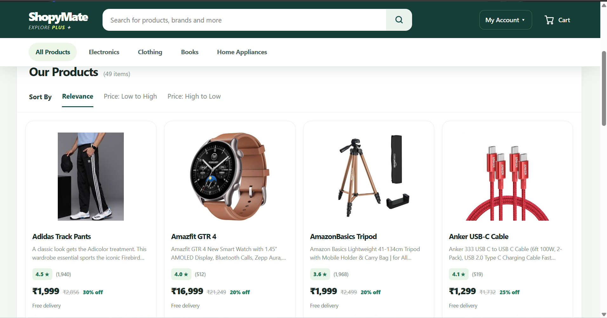
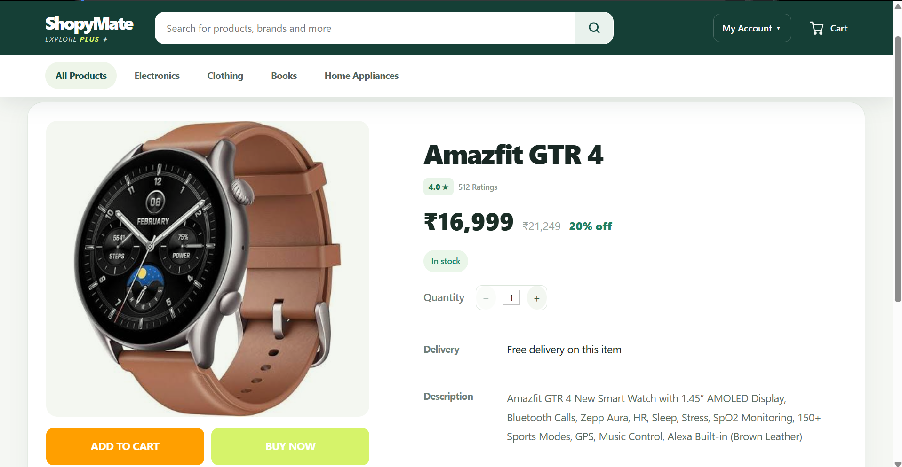
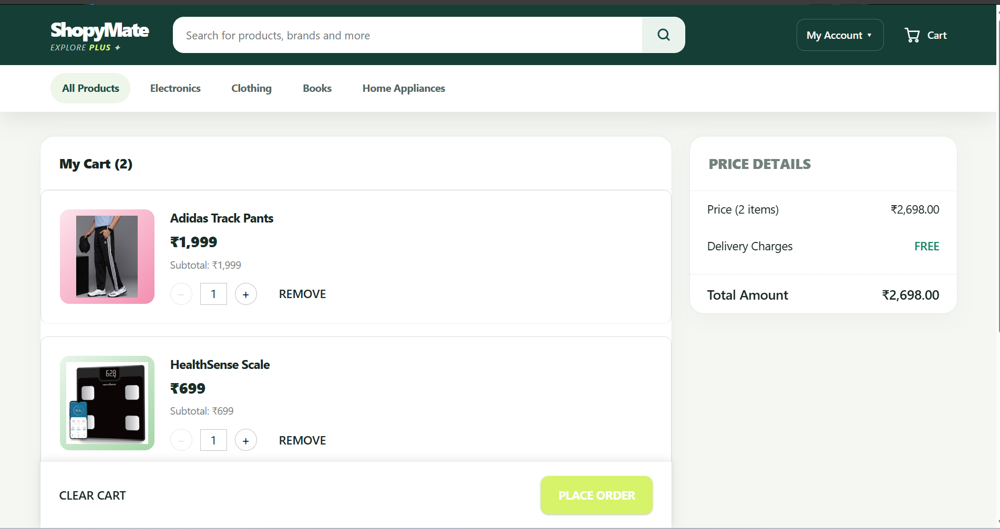

# ShopPlus --- Full-Stack E-Commerce Application

A full-stack e-commerce application built with **React**, **Spring
Boot**, **Spring Security**, **JWT**, and **PostgreSQL**. It includes a
responsive shopping interface, product and category browsing, cart
management, order processing, and administrator tools.

> **Project status:** Frontend source code is available on GitHub. Add
> your live demo URL after deployment.

## Features

### Customer experience

-   Browse products and view product details.
-   Search products and filter by category.
-   Register and log in using JWT-based authentication.
-   Add products to the cart, update quantities, and remove items.
-   Place orders and view order history and order details.
-   Manage profile information and profile image.
-   Email and phone verification flows, where configured.

### Administrator features

-   Create, update, and delete products.
-   Assign products to categories.
-   Upload product images.
-   Manage inventory and review low-stock products.
-   View orders and update order statuses.
-   Restrict administrative operations using role-based authorization.

### Technical features

-   REST API integration between React and Spring Boot.
-   Spring Security with JWT authentication and BCrypt password hashing.
-   PostgreSQL persistence through Spring Data JPA and Hibernate.
-   Centralized frontend API request handling.
-   Responsive styling for desktop and smaller screens.
-   Swagger/OpenAPI documentation, if enabled in the backend.

## Technology Stack

  Area             Technologies
  ---------------- ------------------------------------
  Frontend         React, JavaScript, Vite, CSS
  Backend          Java, Spring Boot, Spring Security
  Authentication   JWT, BCrypt
  Database         PostgreSQL
  Data access      Spring Data JPA, Hibernate
  API style        REST
  Build tools      npm, Maven

## Repository Structure

This repository contains the **frontend** application. The backend is
maintained separately.

``` text
frontend/
├── src/
│   ├── components/     # Shared UI components
│   ├── context/        # React context, including authentication state
│   ├── pages/          # Application pages
│   ├── services/       # API and service functions
│   ├── styles/         # Application styles
│   └── utils/          # Shared utility functions
├── public/
├── index.html
├── package.json
└── vite.config.js
```

The exact files and folders may vary slightly by version.

## Getting Started

### Prerequisites

-   Node.js (LTS recommended)
-   npm
-   A running Spring Boot backend
-   PostgreSQL configured for the backend

### 1. Clone the repository

Replace the placeholders with your actual GitHub repository URL and
folder name:

``` bash
git clone https://github.com/kedarvenkateshkumar/shopymate-ui.git
```

### 2. Install dependencies

``` bash
npm install
```

### 3. Configure the backend API URL

The frontend must call your Spring Boot API. If your project uses a Vite
environment variable for its API base URL, create a local `.env` file in
the frontend root.

Example:

``` env
VITE_API_BASE_URL=http://localhost:8080/api
```

Use this only if your API service reads
`import.meta.env.VITE_API_BASE_URL`. If the service currently uses a
hardcoded URL, update it to read the variable before relying on this
setting. Never put passwords, JWT signing secrets, database credentials,
or other private secrets in frontend environment variables.

### 4. Start the development server

``` bash
npm run dev
```

Open the local URL printed by Vite, usually `http://localhost:5173`.

## Backend Setup

The backend is maintained in a separate repository. Generally:

1.  Clone the backend repository.
2.  Configure the PostgreSQL connection.
3.  Set required security and email configuration through environment
    variables or a local, untracked configuration file.
4.  Configure CORS to allow your frontend origin.
5.  Run the Spring Boot application.

Typical Maven commands:

``` bash
./mvnw spring-boot:run
```

On Windows PowerShell:

``` powershell
.\mvnw.cmd spring-boot:run
```

Follow the exact setup instructions and configuration keys in your
backend repository.

## Main Application Areas

-   **Products:** product listing, search, category filtering, and
    product details.
-   **Cart:** add items, update quantities, remove items, and clear the
    cart.
-   **Orders:** checkout, order history, order details, and permitted
    cancellation/status workflows.
-   **Account:** authentication and profile management.
-   **Admin:** product management, inventory, and order management.

Some features require a running backend, a configured database, and the
appropriate user role.

## API Integration

The frontend communicates with the backend through REST endpoints.
Examples include:

  Purpose             Endpoint
  ------------------- ----------------------------
  Register            `POST /api/auth/register`
  Login               `POST /api/auth/login`
  List products       `GET /api/products`
  Search products     `GET /api/products/search`
  List categories     `GET /api/categories`
  Get cart            `GET /api/cart`
  Place order         `POST /api/orders`
  Get order history   `GET /api/orders`

The backend defines the complete endpoint behavior and authorization
requirements.

## Security Notes

-   Never commit database passwords, JWT signing keys, SMTP credentials,
    access tokens, or real user data.
-   Keep `.env` files and local secret configuration out of Git.
-   Enforce authorization on the backend; hiding admin controls in the
    UI is not sufficient security.
-   Configure production CORS to allow only the deployed frontend
    origin(s).
-   Use HTTPS in production.
-   Use test/demo accounts for portfolio demonstrations.

## Deployment

The frontend can be deployed to a static hosting platform that supports
Vite and GitHub integration. The Spring Boot backend and PostgreSQL
database must also be hosted for end-to-end functionality.

Before sharing a live demo: - Configure the production API URL. -
Configure backend CORS for the deployed frontend domain. - Ensure
product and profile image storage persists across backend restarts and
deployments. - Test authentication, product browsing, category
filtering, cart, checkout, order history, and admin access.

**Live Demo:** *Add URL after deployment*

## Screenshots

Add screenshots of the home page, product listing, product details,
cart, order history, and admin dashboard. For example:


## Screenshots

### Home Page


### Product Listing


### Shopping Cart


### Order History


### Admin Dashboard


### Admin Product Management


### Admin Inventory Management


### Admin Order Managenemt


## Future Improvements

Possible enhancements: - Payment gateway integration. - Product reviews
and ratings. - Wishlist functionality. - Automated frontend and backend
tests. - CI/CD deployment workflow. - Accessibility and performance
improvements.

## Author

**Your Name**

-   GitHub: [Your GitHub profile](https://github.com/kedarvenkateshkumar)
-   LinkedIn: [Your LinkedIn
    profile](https://www.linkedin.com/in/venkatesh-veeramallu/)

------------------------------------------------------------------------

If you find this project useful, feel free to explore the code and share
feedback.
